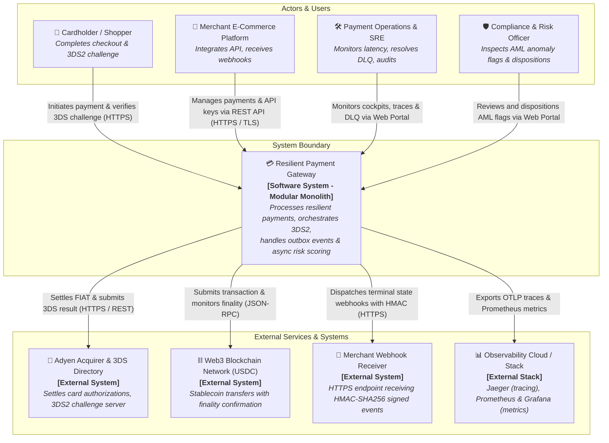
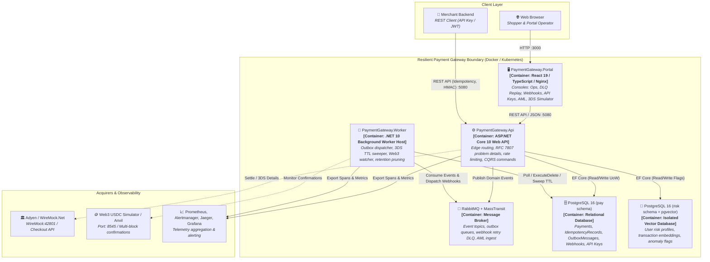
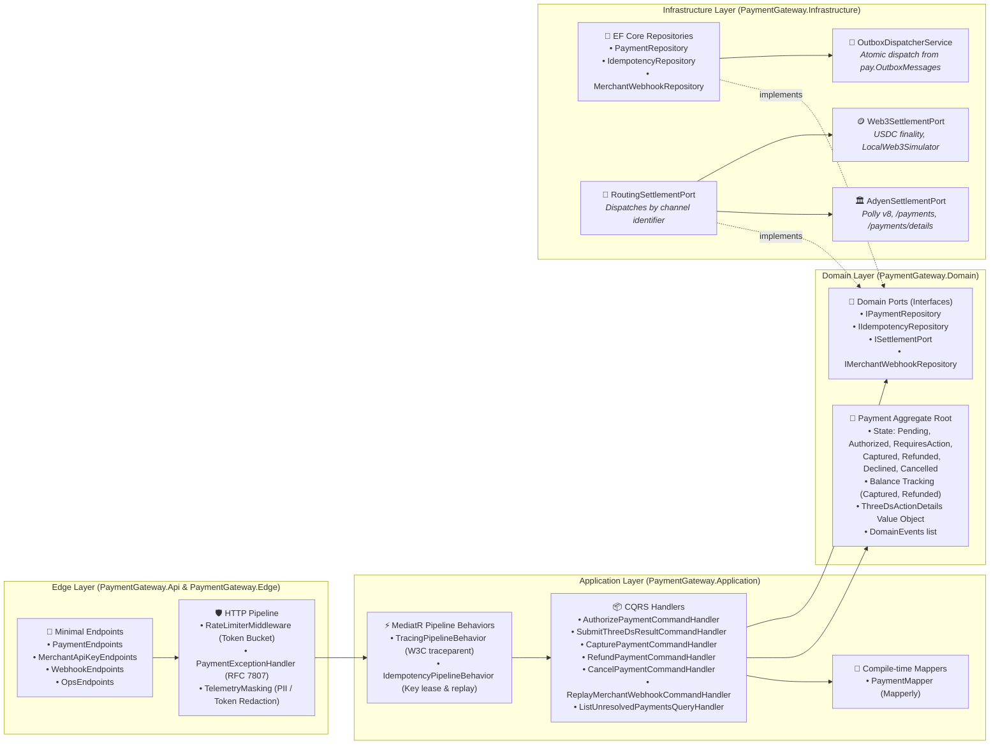

# Architecture Overview

## Technology Stack

| Layer | Choice | Version | Rationale |
| ----- | ------ | ------- | --------- |
| Runtime | .NET | 10 | PRD preference; long-term LTS track for agents |
| Framework | ASP.NET Core Web API + worker host(s) | 10 | HTTP edge + outbox/RISK/channel workers |
| Architecture | Modular monolith, Clean Architecture, CQRS (MediatR) | — | ADR-001 |
| Database | PostgreSQL (+ pgvector for RISK) | 16+ | Relational durability; one compose DB |
| ORM | EF Core | 10 | Migrations, transactional outbox UoW |
| Messaging | RabbitMQ + MassTransit | — | Outbox dispatch; RISK consumer |
| Resilience | Polly v8 | — | HTTP/RPC retries and circuits in adapters |
| Mapping | Mapperly | — | Compile-time; no AutoMapper |
| Auth | JWT Bearer (`merchant` / `risk`) | — | ADR-004 |
| Observability | OpenTelemetry → Jaeger + Prometheus + Grafana in compose | — | EDGE masking at export boundary; PRD stack |
| Adyen mock | WireMock.Net (embedded / compose) | — | Secretless default acquirer |
| Web3 local | Anvil (Foundry) + mock ERC-20 USDC | — | Secretless phase-3 channel |
| Testing | xUnit, FluentAssertions, NetArchTest, Testcontainers | — | ADR-006 |
| Frontend | React 19 + TypeScript (SPA) | 19 | Fast modern SPA for operational consoles (ADR-013) |
| Bundler | Vite | 6+ | Fast dev HMR, lightweight production build (ADR-013) |
| Styling | Tailwind CSS | 4 | Utility-first, standardized design system tokens (ADR-014) |
| Hosting (MVP) | Docker Compose only | — | Cloud-agnostic local ecosystem; not prod topology |

## Architecture Pattern

**Modular monolith** (ADR-001): topic-aligned modules (Pay, Edge, Evt, Adyen, Web3, Risk) share Domain contracts for the payment aggregate, settlement port, and apply-acquirer-outcome (ADR-002). Domain has no Adyen/Web3/MassTransit/EF types — enforced by NetArchTest. Application uses MediatR commands/queries; Infrastructure holds EF, MassTransit, WireMock/live Adyen clients, Web3 RPC, and RISK embeddings.

## C4 Architecture Diagrams

The following diagrams illustrate the system architecture across the C4 model levels: **Context (Level 1)**, **Containers (Level 2)**, and **Components (Level 3)**.

### Level 1: System Context Diagram
Shows the system in its environment, external actors, and third-party integrations.



---

### Level 2: Container Diagram
Decomposes the gateway into deployable runtime containers, datastores, and message brokers.



---

### Level 3: Component Diagram (Core API & Application Engine)
Detailed anatomy of the modular monolith showing Clean Architecture layers, CQRS handlers, and domain ports.



---

## Project Structure

```
src/
  PaymentGateway.Api/           # ASP.NET composition root (HTTP)
  PaymentGateway.Worker/        # Outbox dispatch, reconciliation, Web3 finality, RISK consumer (may merge hosts)
  PaymentGateway.Domain/        # Aggregates, VOs, ports (no infra)
  PaymentGateway.Application/   # CQRS handlers, validators, apply-acquirer-outcome
  PaymentGateway.Infrastructure/# EF, MassTransit, Adyen, Web3, RISK persistence
  PaymentGateway.Edge/          # Problem Details, rate limit, telemetry redaction (or Infrastructure/Edge)
  PaymentGateway.Portal/        # React 19 + Vite SPA (consoles for ops, webhooks, risk)
tests/
  *.UnitTests/
  *.IntegrationTests/           # Testcontainers Postgres + RabbitMQ
  *.ArchitectureTests/          # NetArchTest
compose/
  docker-compose.yml            # api, worker, postgres, rabbitmq, otel/jaeger, prometheus, grafana, wiremock/anvil as needed
.env.example                    # non-secret placeholders; real secrets via User Secrets / compose env (never git)
```

Exact project names may be adjusted at scaffold; module boundaries and NetArchTest rules must not weaken.

## API Conventions

- **Style:** REST JSON under `/api/v1/...` (version in URL).
- **Auth:** JWT Bearer; payment APIs require `merchant`; RISK APIs require `risk` (ADR-004). Adyen notification route: HMAC only, no JWT.
- **Errors:** RFC 7807 `application/problem+json` via EDGE (ADR-007). Stable HTTP status ↔ `type` URI registry in ADR-007 (`urn:rpg:problem:*`). Correlation/trace id on every problem document.
- **Idempotency:** Required header/field on payment commands (ADR-010). Replay vs conflict per payload hash.
- **Success bodies:** Payment resource includes payment id, state, party id, amounts, gateway merchant reference, channel id, channel references (authorize + transitions). Pending/unknown is a **resource state**, not a problem document.
- **Currency catalog (MVP):** Config allow-list of currency/asset codes with minor-unit precision. Phase 1 proves at least EUR (or similar) and **JPY** (zero decimal). Phase 3 adds mock **USDC**. No FX/quoting.
- **CORS:** Configured for Portal origins (`http://localhost:3000`, `http://127.0.0.1:3000`) with allowed headers and preflight handling (ADR-013).

## Database Conventions

- EF Core migrations in Infrastructure; applied at deploy/compose startup (or documented migrate step).
- Tables for payments (with partial balance tracking), transitions/references, idempotency records + leases, outbox, Adyen notification admission keys, RISK verdicts/flags/embeddings (pgvector), and merchant webhook subscriptions (ADR-011, ADR-012).
- Outbox retention: automated background pruning of dispatched entries older than 14 days via EF Core `ExecuteDeleteAsync` (ADR-012).
- Naming: PascalCase entities → snake_case columns preferred via EF convention if scaffold sets it; stay consistent once chosen.
- Money stored as integer minor units + currency/asset code (never float).
- RISK uses a **separate DbContext / connection pool** from PAY/outbox (ADR-009).

## Auth Implementation

Symmetric JWT signing key via User Secrets / compose env (never git). Claims: `sub`, `role` ∈ {`merchant`, `risk`}. Local demo minting documented in scaffold README. Webhook: `[AllowAnonymous]` + HMAC filter (ADR-004, ADR-005 secrets never logged).

## Testing Strategy

- **Approach:** Test-first (TDD) — ADR-006.
- **Test types:** Unit (Domain/Application + fakes); Integration (real Postgres + RabbitMQ); Architecture (NetArchTest); API journeys (happy + significant error path spanning ACs).
- **Frameworks:** xUnit; FluentAssertions; NetArchTest; Testcontainers; `WebApplicationFactory`; WireMock.Net; Anvil where Web3.
- **Mocking policy:** Do not mock EF/MassTransit in durability tests. External live Adyen only when live mode; default WireMock. Clock port where time-sensitive.
- **Test data:** Builders/factories in test projects; smoke fixtures under `.ai/specs/features/{id}/fixtures/` when needed.
- **Harnesses (scaffold):** process kill/restart (outbox); signed-notification HMAC; RISK slow/dead vs PAY latency; optional Anvil reorg.
- **CI gate:** build + unit + integration + NetArchTest; no secrets in repo.

## Design System

Full brand book — palette, typography, spacing, radius, layout grammar, component anatomy, worked screen examples — lives in [ADR-014: Design System](adr/adr-014-design-system.md), with browser-renderable reference at [adr-014-design-system/index.html](adr/adr-014-design-system/index.html).

- **Component library:** Tailwind CSS utility classes and custom primitives
- **CSS framework:** Tailwind CSS v4
- **Design system ADR:** [ADR-014](adr/adr-014-design-system.md) (+ sibling HTML reference folder)
- **App shell:** Sticky top bar (56px) with role switcher and environment info, collapsable left navigation sidebar (240px), centered responsive content container (max 1440px).

## Cross-Cutting Conventions

- **Logging / telemetry:** Structured logs + OpenTelemetry; EDGE redacts instrument/token-shaped fields before export (ADR-007, ADR-005).
- **Error handling:** Domain/application results map to EDGE problem types or payment resource states; never leak secrets in `detail`.
- **Validation:** FluentValidation (or DataAnnotations + handlers) at Application boundary; field identifiers in validation problems.
- **Configuration:** `appsettings` + env; committed **`.env.example`** lists required keys with empty/dummy values. Live Adyen credentials and JWT signing key via User Secrets / compose env only (never git). Settlement **channel id** is deployment config only (ADR-002).
- **Resilience:** Polly v8 on outbound Adyen/Web3 HTTP/RPC; open circuit / unanswered → pending/unknown per channel policy, not silent decline.
- **Compose-only hosting:** One-command local ecosystem (`docker compose up`). No cloud-specific deploy target in MVP. Production topology is out of intake-01 scope.
- **Observability stack:** OTel collector (or ASP.NET OTLP export) → **Jaeger** (traces), **Prometheus** (metrics scrape), **Grafana** (dashboards) in compose — secretless local defaults.

## Adyen admission store

Durable store of successfully admitted notification keys (pspReference + eventCode + merchantReference, or equivalent). Replay of an already-admitted key → reject, no mutation (F-ADYEN-03).

- **Retention TTL (MVP default):** **7 days** (config). Longer than the reconciliation window so late Adyen retries still hit the replay gate.
- **Purge:** background/job at provision time; expired keys may be re-admitted as new (same as PAY idempotency expiry semantics).

## RISK catch-up and DLQ

See ADR-009: at-least-once + event-id dedupe; catch-up after outage within lag budget from RISK recovery; poison messages → RISK DLQ + `degraded` verdict; PAY never awaits RISK.

## Shared unresolved observability contract

Payments left **unresolved** after Adyen reconciliation window or Web3 finality timeout are **ops-visible**, not a new EVT outcome type (ADR-003 closed vocabulary of seven).

- **Metrics:** counter/gauge of unresolved payments by channel id and age bucket.
- **Operator query API:** authenticated read (`GET /api/v1/payments/unresolved` via JWT `role: merchant` or `role: risk`/`ops`) listing unresolved payments filtered by channel and minimum age in minutes (ADR-012).
- **Mutation:** only via apply-acquirer-outcome when channel truth arrives (ADR-002).

## Distributed Tracing & W3C Context Propagation

End-to-end distributed tracing is implemented natively via OpenTelemetry and the W3C Trace Context specification ([ADR-015](adr/adr-015-distributed-tracing-w3c-context-propagation.md)):
- **Edge API & MediatR:** ASP.NET Core instrumentation and MediatR `TracingPipelineBehavior` generate spans tagged with `mediatr.request` and record `ActivityStatusCode.Error` on failure.
- **Transactional Outbox Lineage:** Ambient trace context (`Activity.Current?.Id`) is serialized into `pay.OutboxMessages` as `TraceParent`. `OutboxDispatcherService` extracts and resumes the span (`Outbox.Dispatch`) across asynchronous worker execution without context loss.
- **Merchant Webhooks:** Outbound dispatches propagate the standard `traceparent` HTTP header to merchant endpoints.
- **Masking & Export:** Export through OTLP to Jaeger (`jaeger:4317`) with strict PAN/token redaction (`AddInstrumentMasking`).

## Operational Observability & Alerting Architecture

Real-time telemetry and cluster alerting are managed via Prometheus, Alertmanager, and an in-portal operational cockpit ([ADR-016](adr/adr-016-operational-observability-alerting-console.md)):
- **PromQL Alert Rules (`compose/alert.rules.yml`):**
  - `HighPaymentDeclineRate`: Triggers if payment decline rate exceeds 5% over 5m.
  - `AcquirerSettlementLatencySlaBreach`: Triggers if acquirer p95 latency exceeds 2.0s over 5m.
  - `MerchantWebhookDlqSpike`: Triggers on elevated webhook DLQ exhaustion or replay volume.
  - `OutboxDeliveryDelayOrFailure`: Triggers on outbox drain delays or dead-letter accumulation.
- **Alertmanager Routing (`compose/alertmanager.yml`):** Deduplicates, groups, and routes firing alerts.
- **Portal Observability Cockpit:** Exposes `GET /api/v1/ops/observability` aggregating cluster health, active alerts, latency percentiles, and queue backlogs with direct remediation links to DLQ and Unresolved consoles. Independent resources are evaluated concurrently via `Task.WhenAll`.

## MVP knobs (config, not SLAs)

| Knob | Default (illustrative) | Owner |
| ---- | ---------------------- | ----- |
| Rate limit per JWT `sub` | 100 req/min | EDGE |
| Global in-flight payment requests | 50 | EDGE |
| Idempotency key TTL | 24h | PAY / ADR-010 |
| Adyen notification admission TTL | 7 days | ADYEN |
| Adyen reconciliation window | 15 min | ADYEN |
| Web3 finality depth / timeout | e.g. 1 conf / 2 min local | WEB3 |
| RISK score timeout / lag budget | 5s / 60s | RISK / ADR-009 |
| RISK consumer retry → DLQ | 5 attempts | RISK / ADR-009 |
| Outbox retention TTL | 14 days | EVT / ADR-012 |
| Merchant webhook retry policy | 5 attempts (exp backoff) → DLQ | EDGE / ADR-012 |

## Architecture Decision Records

| ADR | Title |
| --- | ----- |
| [ADR-001](adr/adr-001-modular-monolith-clean-cqrs.md) | Modular monolith, Clean Architecture, CQRS |
| [ADR-002](adr/adr-002-settlement-port-apply-outcome.md) | Settlement port, channel selection, apply-acquirer-outcome |
| [ADR-003](adr/adr-003-transactional-outbox-evt.md) | Transactional outbox and payment lifecycle events |
| [ADR-004](adr/adr-004-jwt-bearer-auth.md) | JWT Bearer authentication |
| [ADR-005](adr/adr-005-card-data-tokens-only.md) | Card data posture — tokens only |
| [ADR-006](adr/adr-006-testing-strategy-tdd.md) | Testing strategy — TDD |
| [ADR-007](adr/adr-007-edge-http-contract.md) | EDGE HTTP contract |
| [ADR-009](adr/adr-009-risk-fail-open-pgvector.md) | RISK fail-open, pgvector, pool isolation |
| [ADR-010](adr/adr-010-idempotency-keys.md) | Idempotency keys, payload hash, in-flight lease |
| [ADR-011](adr/adr-011-partial-settlement-balance-tracking.md) | Partial settlement state machine and balance tracking |
| [ADR-012](adr/adr-012-operational-hardening-outbox-webhooks-query.md) | Operational hardening — outbox retention, merchant outbound webhooks, and unresolved query |
| [ADR-013](adr/adr-013-web-portal-architecture-hosting-cors.md) | Web Portal Architecture, Docker Hosting & CORS Integration |
| [ADR-014](adr/adr-014-design-system.md) | Design System |
| [ADR-015](adr/adr-015-distributed-tracing-w3c-context-propagation.md) | Distributed Tracing and W3C Trace Context Propagation |
| [ADR-016](adr/adr-016-operational-observability-alerting-console.md) | Real-time Operational Observability and Alerting Console |
| [ADR-017](adr/adr-017-cicd-containerization-and-kubernetes-deployment.md) | CI/CD Pipeline Automation, Containerization & Kubernetes Deployment |
| [ADR-018](adr/adr-018-performance-testing-and-resilience-benchmarking.md) | Performance Testing, Load Benchmarking & Rate Limiting Resilience |
| [ADR-019](adr/adr-019-3d-secure-2-and-sca-flow.md) | 3D Secure 2 (3DS2) and Strong Customer Authentication (SCA) Flow |
| [ADR-020](adr/adr-020-recurring-payments-and-card-tokenization.md) | Recurring Payments, Card Tokenization and Subscription Management (CIT / MIT) |
| [ADR-021](adr/adr-021-reconciliation-fee-calculation-and-merchant-payouts.md) | Reconciliation, Fee Calculation and Merchant Payouts |
| [ADR-022](adr/adr-022-openid-connect-keycloak-and-jwks-validation.md) | OpenID Connect (OIDC) Authentication, Keycloak Identity Provider & JWKS Validation |
| [ADR-023](adr/adr-023-cloud-infrastructure-as-code-terraform-aws.md) | Cloud Infrastructure as Code (IaC) with Terraform for AWS EKS, Aurora Serverless & Amazon MQ |

> ADR-008 intentionally unused — compose-only hosting is recorded in this overview, not a separate ADR.
