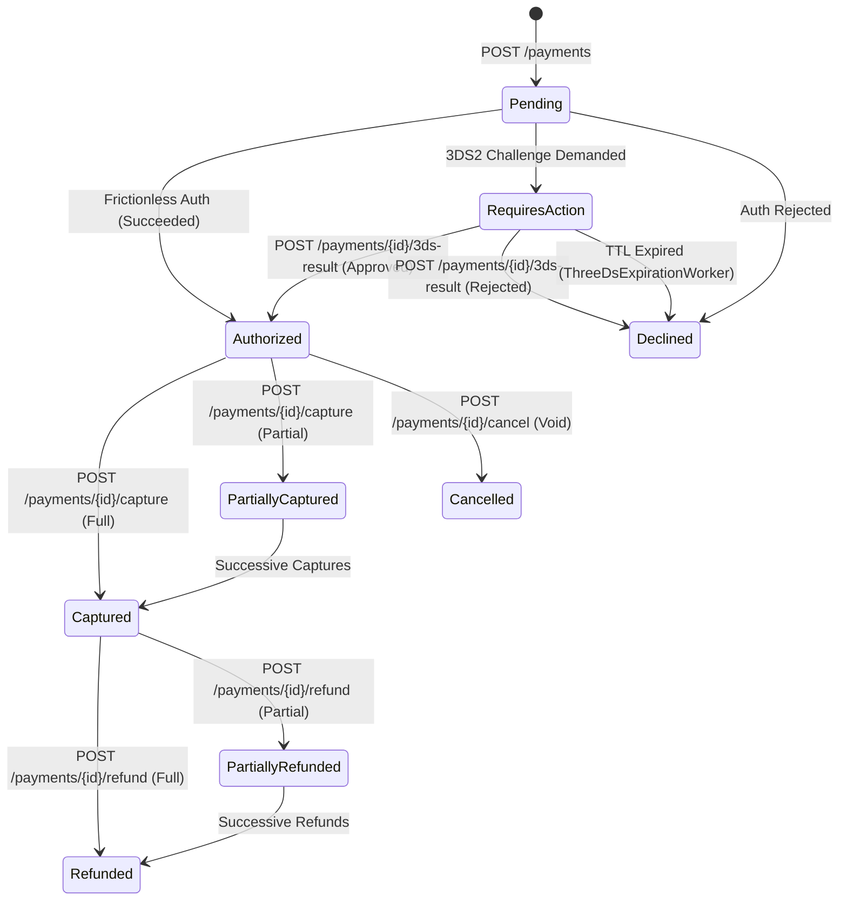

# Merchant Integration Guide

Welcome to the **Resilient Payment Gateway** developer guide. This document provides technical integration instructions, API specifications, and code examples for merchants integrating checkout, payment capture, 3D Secure 2 (SCA), and webhook processing.

---

## 1. Quick Integration Overview

The Resilient Payment Gateway is a high-integrity, multi-channel payment engine supporting card acquirers (Adyen) and Web3 stablecoins (USDC) under a unified API.

### Key Architectural Principles
- **Idempotent by Design**: Every mutating payment request (`POST`) accepts an `Idempotency-Key` header to safely allow retries without duplicate billing.
- **Zero Raw Card Data (PCI-DSS SAQ-A Scope Minimization)**: The gateway operates in a *tokens-only* posture. Card numbers, tokens, or digital wallets are tokenized before reaching core databases.
- **Transactional Outbox & HMAC Webhooks**: Payment lifecycle transitions (`Authorized`, `Declined`, `Captured`, `Refunded`, `Cancelled`) emit cryptographically signed webhooks to your server.

---

## 2. Authentication & Authorization

All requests to the payment API must be authenticated using either an **API Key** or a **JWT Bearer Token**.

### Using an API Key (Recommended)
Include your API Key in the `X-Api-Key` HTTP header:

```http
POST /payments HTTP/1.1
Host: api.gateway.example.com
X-Api-Key: rpg_live_a1b2c3d4e5f6g7h8...
Content-Type: application/json
Idempotency-Key: 9b1deb4d-3b7d-4bad-9bdd-2b0d7b3dcb6d
```

### Key Scopes
Merchant API keys enforce granular scopes:
| Scope | Description | Allowed Operations |
|-------|-------------|--------------------|
| `payments:write` | Initiating and mutating payments | `POST /payments`, `capture`, `refund`, `cancel`, `3ds-result` |
| `payments:read` | Inspecting payments and status | `GET /payments/{id}`, `GET /payments/unresolved` |
| `webhooks:manage`| Configuring webhook endpoints | Registering endpoints, secret rotation, DLQ inspection |

---

## 3. Core Payment Lifecycle

All monetary values are represented as **integers in minor currency units** (e.g., `1000` = 10.00 EUR, `500` = $5.00 USD, `100` = 100 JPY).



---

## 4. API Endpoints Specification

### 4.1 Authorize Payment
Initiates an authorization for a customer order.

- **Method**: `POST /payments`
- **Required Header**: `Idempotency-Key: <unique-uuid-v4>`
- **Required Scope**: `payments:write`

#### Request Payload
```json
{
  "partyId": "cust_982341",
  "amount": 2500,
  "currency": "EUR",
  "settlementChannel": "ADYEN"
}
```

#### Response 1: Instant Authorization (Frictionless Flow)
**HTTP Status:** `201 Created`
```json
{
  "paymentId": "pay_01J9X8R1B2M5K3T7",
  "partyId": "cust_982341",
  "amount": 2500,
  "currency": "EUR",
  "settlementChannel": "ADYEN",
  "state": "Authorized",
  "channelReference": "adyen_tx_99812401",
  "declineReason": null,
  "createdAt": "2026-10-19T14:30:00Z",
  "capturedAmount": 0,
  "remainingAuthorizedAmount": 2500,
  "refundedAmount": 0,
  "remainingRefundableAmount": 0,
  "action": null
}
```

---

### 4.2 3D Secure 2 (SCA) Challenge Handling

When a customer's issuing bank requires Strong Customer Authentication, the response transitions to `RequiresAction`.

#### Response 2: 3DS2 Challenge Required
**HTTP Status:** `201 Created`
```json
{
  "paymentId": "pay_01J9X8R1B2M5K3T7",
  "partyId": "cust_982341",
  "amount": 2500,
  "currency": "EUR",
  "settlementChannel": "ADYEN",
  "state": "RequiresAction",
  "channelReference": "adyen_challenge_001",
  "declineReason": null,
  "createdAt": "2026-10-19T14:30:00Z",
  "capturedAmount": 0,
  "remainingAuthorizedAmount": 0,
  "action": {
    "actionType": "ChallengeShopper",
    "targetUrl": "https://checkoutshopper-live.adyen.com/checkoutshopper/threeDS2.shtml",
    "token": "eyJ0aHJlZURTTWV0aG9kTm90aWZpY2F0aW9uVVJMIjoi...",
    "expiresAt": "2026-10-19T14:45:00Z"
  }
}
```

#### Frontend Challenge Rendering
If using the Adyen Web SDK or standard 3DS iframe:
```javascript
if (paymentResponse.state === 'RequiresAction') {
  // Mount 3DS2 challenge inside customer checkout
  checkout.createFromAction(paymentResponse.action).mount('#three-ds-container');
}
```

#### Submitting 3DS Challenge Completion
Once the customer verifies with their bank (e.g., SMS code or banking app), post the challenge outcome:

- **Method**: `POST /payments/{id}/3ds-result`
- **Required Scope**: `payments:write`

```json
{
  "threeDsResult": "challenge_completed",
  "details": {
    "threeDSResult": "Y"
  }
}
```

**Response (`200 OK`):**
```json
{
  "paymentId": "pay_01J9X8R1B2M5K3T7",
  "state": "Authorized",
  "channelReference": "adyen_auth_final_7761"
}
```

> [!NOTE]
> **Challenge Expiration (TTL)**: If the customer abandons the bank challenge window, the gateway background worker sweeps the transaction upon reaching `expiresAt` and marks it as `Declined` with reason `ThreeDsExpired`.

---

### 4.3 Capture Payment (Full or Partial)
Charges an authorized payment when items ship or services are rendered.

- **Method**: `POST /payments/{id}/capture`
- **Required Header**: `Idempotency-Key: <unique-uuid-v4>`

```json
{
  "amount": 1500
}
```
*Leave `amount` empty or omit to capture the full remaining authorized amount.*

---

### 4.4 Refund Payment (Full or Partial)
Refunds a settled or partially captured payment back to the original funding source.

- **Method**: `POST /payments/{id}/refund`
- **Required Header**: `Idempotency-Key: <unique-uuid-v4>`

```json
{
  "amount": 500
}
```

---

### 4.5 Cancel Payment (Void Authorization)
Releases held funds on an authorized payment before it is captured.

- **Method**: `POST /payments/{id}/cancel`
- **Required Header**: `Idempotency-Key: <unique-uuid-v4>`

```json
{}
```

---

## 5. Webhooks & Event Ingestion

Terminal state transitions trigger an asynchronous HTTP POST webhook to your configured webhook URL.

### Webhook Event Payload
```json
{
  "eventId": "evt_01J9X908M1P4D7E2",
  "eventType": "payment.authorized",
  "paymentId": "pay_01J9X8R1B2M5K3T7",
  "partyId": "cust_982341",
  "amount": 2500,
  "currency": "EUR",
  "outcome": "Authorized",
  "channel": "ADYEN",
  "channelReference": "adyen_tx_99812401",
  "timestamp": "2026-10-19T14:30:05Z"
}
```

### Verifying HMAC-SHA256 Signature
Each delivery contains an `X-Signature` header computed as:
`sha256 = HMAC_SHA256(RawRequestBody, WebhookSecret)`

#### Node.js / TypeScript Verification Example:
```typescript
import crypto from 'crypto';

export function verifyWebhookSignature(
  rawBody: string,
  signatureHeader: string,
  secretKey: string
): boolean {
  const expectedSignature = crypto
    .createHmac('sha256', secretKey)
    .update(rawBody, 'utf8')
    .digest('hex');

  const providedSignature = signatureHeader.replace(/^sha256=/, '');
  
  return crypto.timingSafeEqual(
    Buffer.from(expectedSignature, 'hex'),
    Buffer.from(providedSignature, 'hex')
  );
}
```

### Delivery Resilience & DLQ Policy
- **Retries**: Webhooks retry up to 5 times using exponential backoff with jitter (initial retry ~30s, up to 1h).
- **Dead-Letter Queue (DLQ)**: If your server fails to respond with `2xx` after all attempts, the event lands in the **Webhook DLQ**.
- **Replay**: You can manually replay failed deliveries directly from the **Merchant Portal DLQ Console** or via `POST /api/v1/webhooks/dlq/{eventId}/replay`.

---

## 6. Error Handling & RFC 7807 Problem Details

All error responses return `application/problem+json` formatted according to RFC 7807.

```json
{
  "type": "urn:rpg:problem:conflict",
  "title": "Conflict",
  "status": 409,
  "detail": "Payment pay_01J9X8R1B2M5K3T7 cannot be captured because it is in Declined state.",
  "instance": "/payments/pay_01J9X8R1B2M5K3T7/capture"
}
```

### Common Problem Types
| HTTP Status | Problem Type URI | Meaning |
|-------------|------------------|---------|
| `400 Bad Request` | `urn:rpg:problem:validation` | Missing fields, invalid currency code, or negative amount |
| `401 Unauthorized`| `urn:rpg:problem:unauthorized`| Missing or invalid API Key / JWT Bearer token |
| `403 Forbidden`   | `urn:rpg:problem:forbidden`   | API Key lacks the required permission scope |
| `404 Not Found`   | `urn:rpg:problem:not-found`   | Payment ID does not exist |
| `409 Conflict`    | `urn:rpg:problem:conflict`    | Invalid state transition or duplicate idempotency key payload mismatch |
| `429 Rate Limited`| `urn:rpg:problem:rate-limited`| Rate limit exceeded (Token Bucket). Retry after `Retry-After` header |

---

## 7. Complete Integration Example (Node.js / TypeScript)

```typescript
import axios from 'axios';
import { v4 as uuidv4 } from 'uuid';

const GATEWAY_URL = 'http://localhost:5080';
const API_KEY = process.env.PAYMENT_GATEWAY_API_KEY!;

const client = axios.create({
  baseURL: GATEWAY_URL,
  headers: {
    'X-Api-Key': API_KEY,
    'Content-Type': 'application/json',
  },
});

async function processOrder(customerId: string, orderTotalCents: number) {
  const idempotencyKey = uuidv4();

  try {
    // 1. Authorize Payment
    const res = await client.post(
      '/payments',
      {
        partyId: customerId,
        amount: orderTotalCents,
        currency: 'EUR',
        settlementChannel: 'ADYEN',
      },
      {
        headers: { 'Idempotency-Key': idempotencyKey },
      }
    );

    const payment = res.data;

    // 2. Handle 3DS2 Challenge if required
    if (payment.state === 'RequiresAction') {
      console.log(`Action Required: Redirect shopper to ${payment.action.targetUrl}`);
      // Send action details to browser for 3DS challenge rendering
      return { status: '3ds_required', action: payment.action, paymentId: payment.paymentId };
    }

    if (payment.state === 'Authorized') {
      console.log(`Payment successfully authorized: ${payment.paymentId}`);
      return { status: 'authorized', paymentId: payment.paymentId };
    }

    console.warn(`Payment declined: ${payment.declineReason}`);
    return { status: 'declined', reason: payment.declineReason };
  } catch (error: any) {
    if (error.response) {
      console.error(`Gateway Error [${error.response.status}]:`, error.response.data);
    } else {
      console.error('Network Error during payment processing:', error.message);
    }
    throw error;
  }
}
```
